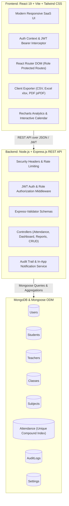

# 🎓 AttendIQ — Production Student Attendance Management System

[](https://nodejs.org/)
[](https://reactjs.org/)
[](https://vitejs.dev/)
[](https://tailwindcss.com/)
[](https://www.mongodb.com/)
[](LICENSE)

A modern, responsive, full-stack **Student Attendance Management System** built for higher education institutions, colleges, and universities. Designed with a clean SaaS aesthetic, robust role-based access control (RBAC), end-to-end data integrity checks, interactive attendance marking, automated percentage calculations, audit logging, and multi-format reporting (CSV, Excel, PDF).

---

## 🏛️ System Architecture



---

## 🔑 Demo Login Credentials

The database automatically initializes with sample institutional data upon startup:

| Role | Email Address | Password | Description |
| :--- | :--- | :--- | :--- |
| **Admin** | `admin@example.com` | `Admin@123` | Full access to departments, classes, subjects, faculty, student roster, global analytics, audit logs, and settings. |
| **Teacher** | `teacher@example.com` | `Teacher@123` | Access to assigned classes and subjects, interactive attendance marker, session history, and reports. |
| **Student** | `student@example.com` | `Student@123` | Read-only personal dashboard, attendance percentage, subject cards, monthly calendar, and PDF transcript. |

> **Tip:** The login screen includes **1-Click Demo Buttons** for instant credential auto-fill!

---

## 🚀 Key Functional Modules

### 1. Attendance Management & Interactive Marker
- **Session-Based Workflow**: Faculty select their assigned class, subject, and session date.
- **Three Attendance Statuses**: `Present`, `Absent`, and `On Duty (OD)`.
- **Bulk Quick Actions**: 1-click **"Mark All Present"** and **"Mark All Absent"**.
- **Individual Controls & Remarks**: Toggle individual statuses and attach session notes (e.g., medical leave, duty permissions).
- **Duplicate Prevention**: Enforced at both the database level via a **unique compound index** (`{ student: 1, subject: 1, date: 1 }`) and the controller layer. Duplicate markings are rejected with `409 Conflict`.
- **Audit History**: All changes and session updates record who made the change, when it occurred, and old vs. new values in `AuditLog`.

### 2. Precise Attendance Calculation Formula
$$\text{Attendance Percentage} = \left( \frac{\text{Present} + \text{On Duty}}{\text{Total Countable Classes}} \right) \times 100$$

- **Present & On Duty** count as attended classes.
- **Absent** counts as missed classes.
- **Eligibility Rules**:
  - $\ge 75\%$: **Eligible** (Green)
  - $65\% - 74.9\%$: **Shortage Warning** (Amber)
  - $< 65\%$: **Critical Shortage** (Red)
- Thresholds are configurable by the administrator in **Institution Settings**.

### 3. Role-Based Dashboards
- **Admin Dashboard**: Real-time KPI counters, 7-day attendance trend line chart, department performance bar chart, overall status pie chart, low attendance warnings table, and recent session activities.
- **Teacher Dashboard**: Daily schedule overview showing today's marked vs. pending classes, quick "Mark Now" actions, list of students with attendance shortage, and conducted session summaries.
- **Student Dashboard**: Overall attendance percentage badge, eligibility indicator, subject-wise progress cards with color coding, monthly breakdown, shortage alerts, and attendance transcript download.

### 4. Interactive Attendance Calendar
- Monthly calendar matrix displaying session badges for every day.
- **Color Indicators**: Green = Present, Red = Absent, Blue = On Duty.
- Click any date to open the lecture session inspector (subject, faculty, status, remarks).
- Subject filter and monthly navigation controls.

### 5. Comprehensive Multi-Format Reports & Analytics
- **6 Report Types**:
  1. Class-Wise Attendance Summary
  2. Subject-Wise Attendance Breakdown
  3. Student-Wise Performance Transcript
  4. Low Attendance Alert Report ($< 75\%$)
  5. Daily Session Attendance Logs
  6. Faculty Activity & Conducted Session Logs
- **Export Options**: One-click export to **CSV**, formatted **Excel (.xlsx)**, and **PDF** with official college letterhead.

---

## 🛠️ Technology Stack

### Frontend
- **React.js 19** with **Vite 8**
- **Tailwind CSS v4** (`@tailwindcss/vite`)
- **React Router DOM v7**
- **Axios** with Bearer interceptors & automatic session expiration handling
- **Recharts** for responsive charts & data visualizations
- **Lucide React** for icons
- **Sonner** for toast notifications
- **Day.js** for date handling
- **jsPDF & jsPDF-AutoTable** for PDF generation
- **XLSX (SheetJS)** for Excel export

### Backend
- **Node.js 24** & **Express.js** REST API
- **JSON Web Tokens (JWT)** for stateless authentication
- **bcrypt.js** for salted password hashing
- **Express-Validator** for API payload validation
- **Helmet** for HTTP security headers
- **CORS** configured for cross-origin security
- **Express-Rate-Limit** for brute-force attack prevention
- **MongoDB & Mongoose ODM** with indexed queries and compound constraints
- **MongoMemoryServer** automatic fallback for instant zero-dependency local development

---

## 💻 Local Setup & Installation

### Prerequisites
- Node.js (v18 or higher)
- npm (v9 or higher)

### Step 1: Clone or Navigate to the Repository
```bash
cd d:\AttendanceManagementSystem
```

### Step 2: Install Server Dependencies
```bash
cd server
npm install
```

### Step 3: Install Client Dependencies
```bash
cd ../client
npm install
```

### Step 4: Run Database Seed Script
```bash
cd ../server
npm run seed
```
*(Populates 1 Admin, 5 Faculty members, 50 Students, 3 Departments, 5 Classes, 10 Subjects, and 30 days of attendance history across 2,025 session entries).*

### Step 5: Start the Application

**Terminal 1 (Backend Server):**
```bash
cd server
npm start
# Server starts on http://localhost:5000
```

**Terminal 2 (Frontend Client):**
```bash
cd client
npm run dev
# Vite client starts on http://localhost:5173
```

Open `http://localhost:5173` in your browser.

---

## 🧪 Automated End-to-End API Test Suite

The system includes an automated verification script that tests authentication, role-based access control, dashboard calculations, attendance marking, duplicate prevention, and reports.

To run the test suite:
```bash
node test_e2e.js
```

**Test Verification Results:**
```text
======================================================
🧪 RUNNING COMPREHENSIVE E2E VERIFICATION TEST SUITE
======================================================

✅ [PASS] Health Check endpoint responds 200 OK
✅ [PASS] Admin Login succeeds with JWT and role: admin
✅ [PASS] Teacher Login succeeds with JWT and role: teacher
✅ [PASS] Student Login succeeds with JWT and role: student
✅ [PASS] Invalid Login properly rejected with 401 Unauthorized
✅ [PASS] Role-Based Access Control: Student is blocked with 403 from Admin Settings
✅ [PASS] Admin Dashboard returns comprehensive statistics & Recharts data from MongoDB
✅ [PASS] Teacher Dashboard returns assigned classes, subjects and today's schedule
✅ [PASS] Student Dashboard accurately calculates overall percentage and course breakdown
✅ [PASS] Interactive Student Attendance Calendar returns monthly date matrix
✅ [PASS] Class-wise Reports API generates accurate attendance metrics
✅ [PASS] Low Attendance Report identifies students below configurable percentage
✅ [PASS] Teacher Attendance Marking: Successfully marked attendance session (201 Created)
✅ [PASS] Database Constraint & Validation: Duplicate attendance submission prevented with 409 Conflict
✅ [PASS] Audit Trail API records actions with timestamp, user identity, and change metadata
✅ [PASS] Admin Settings: Configurable minimum eligibility percentage (75%) verified

======================================================
🎉 TEST SUMMARY: 16/16 TESTS PASSED! (100%)
======================================================
```

---

## 📡 REST API Reference

### Authentication
- `POST /api/auth/login` — Sign in and receive JWT token
- `GET /api/auth/me` — Get current authenticated user profile
- `POST /api/auth/logout` — Logout session
- `POST /api/auth/forgot-password` — Generate password reset token
- `POST /api/auth/reset-password` — Reset password using token
- `PUT /api/auth/change-password` — Change password for authenticated user

### Dashboards
- `GET /api/dashboard/admin` — Total counts, today percentage, 7-day trend, department stats, low attendance students
- `GET /api/dashboard/teacher` — Assigned classes, subjects, today's schedule status, low attendance in courses
- `GET /api/dashboard/student` — Overall attendance %, subject breakdown, monthly breakdown, shortage warnings

### Attendance
- `POST /api/attendance` — Mark attendance for class session (Faculty/Admin)
- `GET /api/attendance` — Query records with filters (date range, class, subject, student, status)
- `GET /api/attendance/session` — Fetch existing records for a session
- `PUT /api/attendance/session` — Modify attendance records with audit logging
- `GET /api/attendance/calendar` — Monthly calendar data matrix for student
- `GET /api/attendance/audit-logs` — Audit log trail of all attendance operations

### Students & Faculty Management
- `GET /api/students` — Paginated student directory with search & department/class filters
- `POST /api/students` — Register student (automatically creates login user)
- `GET /api/students/:id` — View student profile with attendance transcript
- `PUT /api/students/:id` — Update student details
- `DELETE /api/students/:id` — Remove student
- `POST /api/students/bulk-import` — Bulk import students from CSV
- `GET /api/teachers` — List faculty members with assigned courses and classes
- `POST /api/teachers` — Register faculty member
- `PUT /api/teachers/:id/assign` — Assign subjects and classes to faculty member
- `DELETE /api/teachers/:id` — Remove faculty member

### Academic Structure
- `GET /api/departments` / `POST /api/departments` / `PUT /api/departments/:id` / `DELETE /api/departments/:id`
- `GET /api/classes` / `POST /api/classes` / `PUT /api/classes/:id` / `DELETE /api/classes/:id`
- `GET /api/subjects` / `POST /api/subjects` / `PUT /api/subjects/:id` / `DELETE /api/subjects/:id`

### Reports & Settings
- `GET /api/reports` — Generate class-wise, subject-wise, student-wise, low-attendance, and daily reports
- `GET /api/settings` — Get institution settings (minimum %, critical %, edit window)
- `PUT /api/settings` — Update institution settings (Admin only)
- `POST /api/notifications/announce` — Broadcast campus announcement

---

## 🚢 Deployment Guide

### Frontend Deployment (Vercel)
1. Push repository to GitHub.
2. Link project to Vercel with Root Directory set to `client`.
3. Set build command to `npm run build` and output directory to `dist`.
4. In Vercel Environment Variables, configure:
   ```env
   VITE_API_URL=https://your-backend-api.onrender.com/api
   ```
5. `client/vercel.json` is already configured for single-page application rewrites.

### Backend Deployment (Render)
1. Create a new **Web Service** on Render pointing to the `server` directory.
2. Build command: `npm install`
3. Start command: `npm start`
4. In Render Environment Variables, configure:
   ```env
   NODE_ENV=production
   PORT=10000
   MONGODB_URI=mongodb+srv://<username>:<password>@cluster0.mongodb.net/attendance_db?retryWrites=true&w=majority
   JWT_SECRET=your_production_secret_key_random_string_2026
   JWT_EXPIRE=7d
   ```

### Database Deployment (MongoDB Atlas)
1. Create a free M0 cluster on [MongoDB Atlas](https://www.mongodb.com/atlas).
2. Create a database user with read/write access.
3. Allow network access from Render IP (`0.0.0.0/0`).
4. Copy the connection string into the `MONGODB_URI` environment variable.

---

## 📄 License
This project is licensed under the ISC License.

